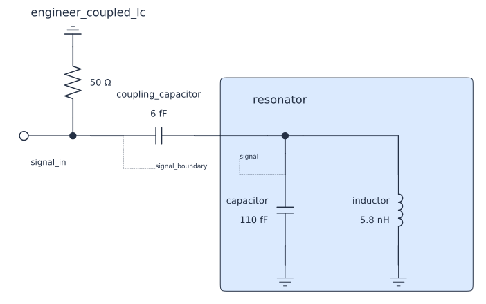
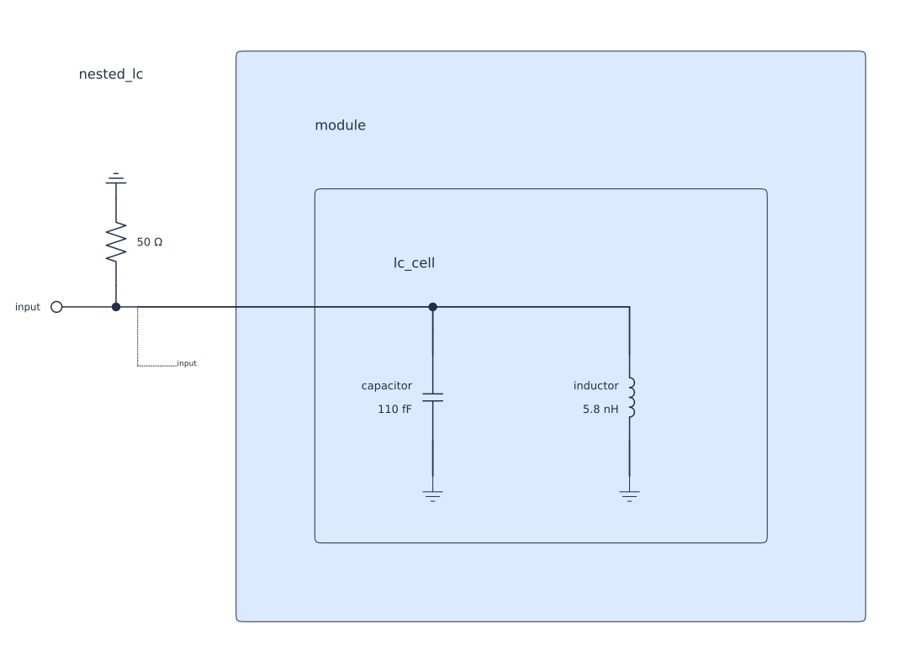
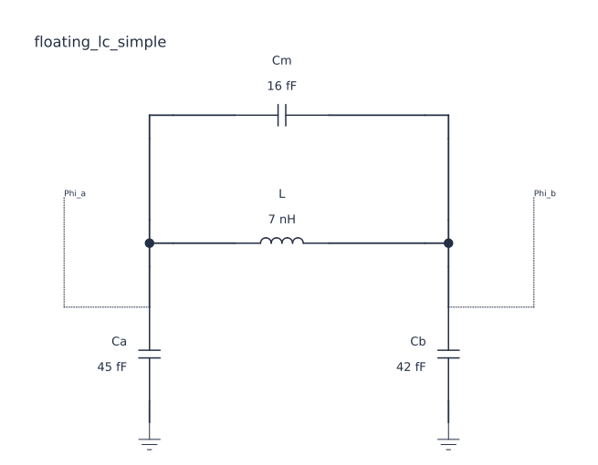

# SCNSim

**SCNSim is under heavy development.**

**Describe a superconducting circuit, choose what to observe, and calculate the response or physical quantity you need.**

[](LICENSE)
[](pyproject.toml)
[](https://ncuphy-ltlab.github.io/scnsim/)


SCNSim is a Python package for superconducting circuit-network analysis. Build an explicit `CircuitPlan`, choose an analysis boundary with a `View`, and ask `CircuitRun` for responses or physical quantities.

## What you can do

- [Compose a physical Plan](docs/concepts/physical-authority-and-reusable-composition.qmd) — Connect components in a `CircuitPlan` and group reusable physical units inside `Subsystem` boundaries.
- [Choose a View and retain coordinates](docs/concepts/compilation-coordinates-and-network-views.qmd) — Select the network to observe with a `View`; `retain()` chooses the coordinates kept for its calculation.
- [Calculate responses, roots, sensitivity and optimization](docs/guides/roots-and-branch-selection.qmd) — Request S, Y or Z response, evaluate characteristic quantities, calculate local sensitivity, or optimize a declared objective.
- [Keep results in memory or a Workspace](docs/concepts/requests-execution-and-result-ownership.qmd) — Use in-memory results for interactive work or a Workspace for supported persistence, exact readback and continuation.
- [Nonlinear Josephson circuits — under design](docs/component-authoring.qmd) — The current Josephson-junction primitive is linearized. A complete nonlinear Josephson-circuit workflow is under design.

## Install

Install a prebuilt CPython 3.12 wheel from [GitHub Releases](https://github.com/NCUPHY-LTLab/scnsim/releases/tag/v1.0.0a3).

From an empty folder, initialize a project, then run the command for your platform:

```sh
uv init --python 3.12
```

<details>
<summary>Windows x86_64 (AMD64)</summary>

```powershell
uv add "scnsim @ https://github.com/NCUPHY-LTLab/scnsim/releases/download/v1.0.0a3/scnsim-1.0.0a3-cp312-cp312-win_amd64.whl"
```

</details>

<details>
<summary>macOS arm64</summary>

```sh
uv add "scnsim @ https://github.com/NCUPHY-LTLab/scnsim/releases/download/v1.0.0a3/scnsim-1.0.0a3-cp312-cp312-macosx_12_0_arm64.whl"
```

</details>

<details>
<summary>Linux x86_64</summary>

```sh
uv add "scnsim @ https://github.com/NCUPHY-LTLab/scnsim/releases/download/v1.0.0a3/scnsim-1.0.0a3-cp312-cp312-manylinux1_x86_64.manylinux_2_28_x86_64.manylinux_2_5_x86_64.whl"
```

</details>

| Python | Platform and architecture | Prebuilt wheel |
|---|---|---|
| CPython 3.12 | Windows x86_64 (AMD64) | [GitHub Release wheel](https://github.com/NCUPHY-LTLab/scnsim/releases/download/v1.0.0a3/scnsim-1.0.0a3-cp312-cp312-win_amd64.whl) |
| CPython 3.12 | macOS arm64 (Apple Silicon) | [GitHub Release wheel](https://github.com/NCUPHY-LTLab/scnsim/releases/download/v1.0.0a3/scnsim-1.0.0a3-cp312-cp312-macosx_12_0_arm64.whl) |
| CPython 3.12 | Linux x86_64 | [GitHub Release wheel](https://github.com/NCUPHY-LTLab/scnsim/releases/download/v1.0.0a3/scnsim-1.0.0a3-cp312-cp312-manylinux1_x86_64.manylinux_2_28_x86_64.manylinux_2_5_x86_64.whl) |

These prebuilt wheels do not require a C++ compiler. For other Python versions or platforms, see the [Contribution guide](docs/contribute.qmd#build-from-source) for source-build instructions. The [setup guide](examples/engineer/setup.qmd) covers optional Jupyter and course requirements.

## A first circuit

Chapter 1 builds a grounded LC resonator inside a `Subsystem`, then connects a coupling capacitor and terminated measurement Port at the parent level. The same Plan supports a one-port response and a loaded root.



A `Subsystem` can contain another `Subsystem`. The boundary makes ownership visible while the parent connects through the child’s exposed Pins.



## Inspect the differential mode with a View

For the two node-flux coordinates, the differential coordinate is `Phi_a - Phi_b`. `transform_pair()` changes basis and `retain()` selects the differential coordinate for the View. A retained View eliminates the common coordinate through the Schur complement and evaluates the requested root in the differential coordinate.



The [documentation overview](https://ncuphy-ltlab.github.io/scnsim/) includes the complete View example.

See the full [floating model](examples/engineer/figures/floating_model_simple.py) and [View example](examples/engineer/figures/floating_view_simple.py).

## Chapter 1 S11 response

Port 1 is `signal_in`; S11 is reflection at that same measurement Port. The ideal lossless one-port model stays near 0 dB in magnitude across the requested frequency grid, while phase shows the response feature.


Open the [documentation site](https://ncuphy-ltlab.github.io/scnsim/) for the interactive magnitude and phase plots.

<details>
<summary>Show the complete model, solve, and S11 plotting code</summary>

```python
import numpy as np
from IPython.display import display
from scnsim import (
    CircuitPlan, CircuitRun, DirectSolveSpec, ParameterSet, components, units as u,
)

plan = CircuitPlan(id="overview_coupled_lc")
resonator = plan.subsystem(id="resonator")
capacitor = resonator.add(components.capacitor(
    id="capacitor", capacitance=110.0*u.fF,
))
inductor = resonator.add(components.inductor(
    id="inductor", inductance=5.8*u.nH,
))
resonator_bus = resonator.bus(id="signal")
resonator.parallel(
    id="parallel_lc", start=resonator_bus,
    branches=((capacitor,), (inductor,)), end=resonator.ground,
)
terminal = resonator.expose_pin(id="terminal", at=resonator_bus)
signal_bus = plan.bus(id="signal_boundary")
coupler = plan.add(components.capacitor(
    id="coupling_capacitor", capacitance=6.0*u.fF,
))
plan.series(id="coupling", start=signal_bus, elements=(coupler,), end=terminal)
plan.add_port(
    id="signal_in", at=signal_bus, role="terminated",
    reference_impedance=50.0*u.ohm,
)
frequencies = np.linspace(5.75, 6.25, 401)*u.GHz
run = CircuitRun(plan=plan, storage="memory")
try:
    baseline_response = run.solve(
        run.original, DirectSolveSpec(frequencies=frequencies),
        parameters=ParameterSet(),
    )
    magnitude_plot = baseline_response.s.plot(component="magnitude", magnitude="db")
    phase_plot = baseline_response.s.plot(component="phase")
    for figure, component, unit in (
        (magnitude_plot, "magnitude", "dB"),
        (phase_plot, "phase", "deg"),
    ):
        figure.update_layout(
            template="plotly_white", autosize=True, height=340, showlegend=False,
            title={"text": f"S11 {component}", "x": 0.02, "xanchor": "left", "font": {"size": 18}},
            font={"family": "Arial, sans-serif", "size": 14, "color": "#243344"},
            margin={"l": 78, "r": 24, "t": 55, "b": 62},
            paper_bgcolor="white", plot_bgcolor="white",
        )
        figure.update_xaxes(
            title_text="Frequency (GHz)", ticks="outside", showline=True,
            linecolor="#6f7b85", gridcolor="#e5e9ed", zeroline=False,
            automargin=True, title_standoff=12,
        )
        figure.update_yaxes(
            title_text=f"{component.capitalize()} ({unit})", ticks="outside",
            showline=True, linecolor="#6f7b85", gridcolor="#e5e9ed",
            zeroline=False, automargin=True, title_standoff=12,
        )
    magnitude_plot.update_yaxes(range=[-0.05, 0.05])
    display(magnitude_plot)
    display(phase_plot)
finally:
    run.close()
```
</details>

## Agent knowledge start

<!-- agent-knowledge-start:begin -->
SCNSim describes a physical circuit with a `CircuitPlan`; a `View` selects the analysis boundary, and a `Spec` names the requested quantity. Start with the [Engineer course](docs/index.qmd), then use the [Concept overview](docs/concepts/index.qmd) for circuit composition and analysis Views.
<!-- agent-knowledge-start:end -->

## Continue

Read [Inputs and units](docs/tutorials/inputs-units.qmd), browse the [Engineer course](https://ncuphy-ltlab.github.io/scnsim/), or open the [Contribution area](docs/contribute.qmd) for source setup and developer guidance.

## License

Apache-2.0; see [LICENSE](LICENSE) and [NOTICE](NOTICE).
