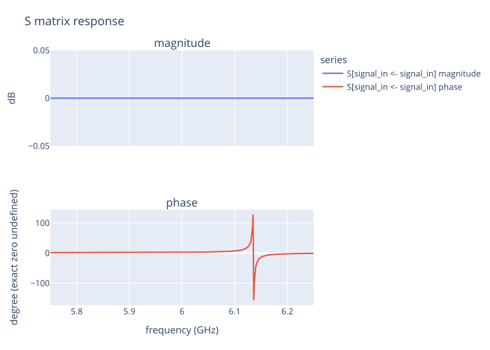

# SCNSim

**Model a superconducting circuit, calculate its response, and explore how its
parameters shape the quantities you care about.**

[](https://github.com/OrPenStrike/scnsim/actions/workflows/ci.yml?query=branch%3Adevelop)
[](LICENSE)
[](pyproject.toml)
[](docs/index.qmd)


SCNSim is a notebook-first Python package for superconducting circuit-network
analysis. Describe components and connections in a `CircuitPlan`, choose the
network to observe through a View, and use `CircuitRun` to calculate typed
Results with physical units. Reuse the same model for responses, characteristic
quantities, derivatives and parameter searches.

## What do you want to calculate?

| Calculation | Start here |
|---|---|
| **Circuit response** — S, Y and Z matrices or a named reflection/transmission trace | `run.solve(view, DirectSolveSpec(...))` |
| **Characteristic quantities** — selected operator, root, pole, transfer zero or coupling | `run.evaluate(view, spec, parameters=point)` |
| **Sensitivity** — how a quantity changes with circuit parameters | `run.sensitivity(SensitivitySpec(...))` for Jacobian, JVP or VJP |
| **Parameter exploration** — compare a declared sweep or search scalar objectives | Supply a `ParameterSpace` to solve/evaluate, or use `run.optimize(view, OptimizationSpec(...))` |

Read the [Concept overview](docs/concepts/index.qmd) to connect a physical model,
View and quantity before choosing an API. The
[roots and branch-selection guide](docs/guides/roots-and-branch-selection.qmd)
explains why a sampled notch, a complex zero and a local Hint are different
questions. The [Sensitivity guide](docs/guides/sensitivity.qmd) explains units
and local derivatives. Optimization offers CMA-ES, L-BFGS-B, value-first
projected L-BFGS and ordered Hybrid stages; choose the method for your objective
and available derivatives.

## Work in memory or save a Workspace

Both modes use the same JAX physical program. For interactive calculations,
`CircuitRun(plan=plan, storage="memory")` keeps Results in RAM without creating
a Workspace. Use `CircuitRun(plan=plan, workspace=path)` when you want to save
calculations, read them again, or continue supported optimization work later.
JAX CPU and Float64/Complex128 are the defaults.

Each operation releases its temporary numerical resources automatically.
Returned Results remain usable after `run.close()`, so plotting, comparing and
reporting do not require keeping a Run open. See
[requests, execution and Result ownership](docs/concepts/requests-execution-and-result-ownership.qmd)
for the storage-specific read, recovery and continuation capabilities.

For repeated calculations, `run.warmup(...)` prepares known executable work
without solving the model. Advanced JAX users can acquire a detached callable
with `run.prepare(...)`. [Benchmark](docs/guides/benchmark.qmd) helps explain
where a calculation spends time. These tools support the calculations above;
they do not change which physical quantity you requested.

## A first Direct S11 result

This Chapter 1 example builds a grounded parallel LC resonator, couples it to
one terminated 50 Ω measurement Port, and requests a named reflection trace.
The physical model and 110 fF / 120 fF values follow the Engineer course.

```python
import numpy as np

from scnsim import (
    CircuitPlan,
    CircuitRun,
    DirectSolveSpec,
    ParameterDefinitions,
    ParameterSet,
    ParameterSpec,
    SParameterTrace,
    components,
    units as u,
)

inputs = ParameterDefinitions(id="readme_lc")
capacitance = inputs.parameter(
    id="capacitance",
    baseline=110.0 * u.fF,
    spec=ParameterSpec(unit=u.fF),
)

plan = CircuitPlan(id="readme_coupled_lc")
resonator = plan.subsystem(id="resonator")
capacitor = resonator.add(
    components.capacitor(id="capacitor", capacitance=capacitance)
)
inductor = resonator.add(
    components.inductor(id="inductor", inductance=5.8 * u.nH)
)
resonator_bus = resonator.bus(id="signal")
resonator.parallel(
    id="parallel_lc",
    start=resonator_bus,
    branches=((capacitor,), (inductor,)),
    end=resonator.ground,
)
resonator_pin = resonator.expose_pin(id="terminal", at=resonator_bus)

signal_bus = plan.bus(id="signal_boundary")
coupling = plan.add(
    components.capacitor(id="coupling_capacitor", capacitance=6.0 * u.fF)
)
plan.series(
    id="coupling", start=signal_bus, elements=(coupling,), end=resonator_pin
)
plan.add_port(
    id="signal_in",
    at=signal_bus,
    role="terminated",
    reference_impedance=50.0 * u.ohm,
)

run = CircuitRun(plan=plan, workspace="workspaces/readme_lc")
reflection = SParameterTrace(
    id="reflection",
    input_port="signal_in",
    input_mode=(),
    output_port="signal_in",
    output_mode=(),
)
direct_spec = DirectSolveSpec(
    frequencies=np.linspace(5.75, 6.25, 401) * u.GHz,
    traces=(reflection,),
)
baseline = run.solve(run.original, direct_spec, parameters=ParameterSet())
selected = run.solve(
    run.original,
    direct_spec,
    parameters=ParameterSet({capacitance: 120.0 * u.fF}),
)
baseline_s11 = baseline.traces["reflection"]
selected_s11 = selected.traces["reflection"]
baseline_s11.show(component="magnitude", magnitude="db")
selected_s11.show(component="magnitude", magnitude="db")
```

The code uses the default JAX backend. The S11 figures below are the existing
Chapter 1 Julia outputs for this authored case and channel; the website does
not run the example to regenerate them.



*Stored Chapter 1 baseline Result: 110 fF. The magnitude axis uses a fixed ±0.05 dB display range; the wrapped phase discontinuity is presentation, not solver failure. [Exact complex samples](examples/engineer/figures/01-s11-data.csv).*


*Stored Chapter 1 selected Result: 120 fF, with the same 5.8 nH inductor, 6 fF coupler, 50 Ω Port, and 401-point grid. No dip or resonance is inferred from this plot. [Exact complex samples](examples/engineer/figures/01-s11-data.csv).*

Continue with the [Engineer course](docs/index.qmd).

## Install

The 1.0 beta is distributed through [GitHub Releases](https://github.com/OrPenStrike/scnsim/releases).
Choose the matching CPython 3.12 wheel for Linux x86_64 or macOS arm64:

```bash
uv venv --python 3.12 .venv
uv pip install --python .venv/bin/python /path/to/scnsim-wheel.whl
```

A matching prebuilt SCNSim wheel does not require a C++ compiler. Installing
from source requires a C++17 toolchain. For a notebook environment, source
installation and optional backends, see the
[setup guide](examples/engineer/setup.qmd). Julia-only features use explicit
backend selection and a separately provided Julia installation; see
[Direct and HB realizations](docs/concepts/direct-and-hb-realizations.qmd).

## Learn the model, then choose the calculation

Start with the [Concept overview](docs/concepts/index.qmd) for the mental model,
or follow the [Engineer course](docs/index.qmd) to build and calculate an
example. Use the focused guides for
[roots and branch selection](docs/guides/roots-and-branch-selection.qmd),
[Sensitivity](docs/guides/sensitivity.qmd) and
[Benchmark](docs/guides/benchmark.qmd) when those questions arise.

## License

Apache-2.0; see [LICENSE](LICENSE) and [NOTICE](NOTICE).
