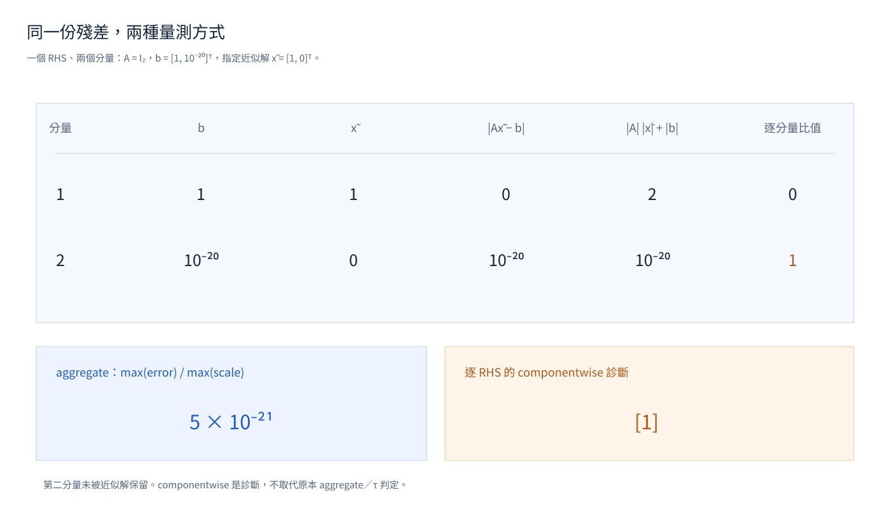

These tests show three separate responsibilities: route an actual owned native error without hiding it, return the certificate of every equation from a compiled program, and describe the solution that a linear solve actually returned. The routing fixtures transport errors; they do not solve a physical circuit.

{#fig-residual-metrics}



[Open the interactive Plotly diagram](figures/residual-metrics.html).

## Native failure routing

The routing cases construct scalar, batched, and archived equation errors with a real checkify error payload. For an error owned by the declared operation, the wrapper must preserve the original status, failing batch indices, source site, response context, and payload through the wrapper layers. A sparse equation fixture uses status 7; the test checks that the original status and payload bits survive.

1. Route a sparse equation error owned by the declared operation and confirm its status, batch indices, source site, response context, and payload survive.
2. Pass an unknown or mixed error and confirm the original runtime error and cause are re-raised. Invalid wrapper combinations are rejected, and inactive checks do not become thrown failures.

These cases catch swallowed native errors and wrappers that claim an error they cannot interpret. Source: [`test_native_failure_routing.py`](test_native_failure_routing.py).

## Equation certificates from a compiled program

Every equation SCNSim solves returns a certificate: a status, the backward residual `eta` with its numerator and denominator, and whether the solve was performed. These cases solve one banded four-node complex system inside a compiled JAX program and read the certificates back as rows. Each row is identified by its role, stage, derivative order and dependency.

| Case | What the rows must show |
| --- | --- |
| Solved, failed, skipped and not run | An equation that did not run is marked absent, with status 0 and NaN residual values. A solve skipped after an earlier failure carries that failure's status and is marked as not performed. A singular matrix reports the stage of its equation as status, with infinite residual values. |
| `cond`, `while_loop` and `scan` | An equation keeps one row. A branch that was not taken and a loop without a trip leave it absent. A loop reports its first failure, otherwise its latest trip. |
| `vmap` | A row has one entry per lane. A lane is absent in the branch it did not take. |
| Derivative equations | Reverse mode adds an adjoint row, forward mode a tangent row, a second forward derivative a mixed row, and a frequency jet a frequency-tangent row. A failed primal equation skips its derivative equation. |
| Derivative availability | The null-vector chart records whether its derivative is available only where its derivative rule ran, with its dependency and reason, separately for each lane, and also under reverse mode. |
| Sequentially mapped Newton body | Lanes that stop after different trip counts, including a lane without a trip and a failing lane, return their rows with a lane axis. |
| Single precision | Complex64 operands keep float32 certificate values, and the global x64 setting is unchanged. |

No tolerance is asserted. The cases check status codes, the performed and present flags, and whether the residual values are finite, infinite, NaN or exactly zero. A zero right-hand side gives an exactly zero residual, which shows which trip a loop reports.

One separate test records the `site` label of each row and the order in which rows are returned. `site` is the position of an equation in the traced program, counting JAX's own equations, so no other case relies on it. Source: [`test_certificate_transport.py`](test_certificate_transport.py).

## Solve diagnostics

A small identity-matrix system makes the aggregate metric differ from a componentwise diagnostic. With `A = I₂`, one right-hand side containing two components, `b = [1, 1e-20]`, and approximate solution `x = [1, 0], the aggregate normalized residual is `5e-21`, while the second equation component has residual 1. The aggregate metric satisfies the original solver threshold even though the per-RHS diagnostic exposes that component. A separate two-column case checks per-RHS values `[1, 0]` when the second solution column is exact.

The dense case compares diagnostics with the actual original solve result. Sparse and compensated paths also retain the original solution and their four auxiliary scalar values. No new threshold is introduced: the test checks that diagnostic fields describe the solve that ran and do not hide a failing right-hand side behind aggregation. Source: [`test_solve_diagnostics.py`](test_solve_diagnostics.py).
