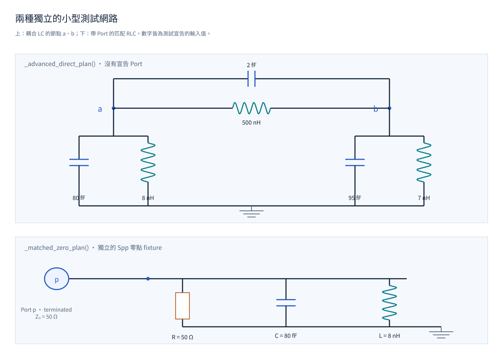

[English](network-roots.md) · [繁體中文](zh-TW/network-roots.md)

These cases start with declared circuit branches and compare requested network quantities with independent calculations. `Q(ω)` is the frequency-dependent dynamic-stiffness matrix; it is distinct from the quality factor `Q` used in the resonator examples. Similar-looking circuits on this page are separate fixtures.

## A two-node LC equation

The advanced Direct fixture has node `a` connected to ground through 80 fF in parallel with 8 nH, node `b` through 95 fF in parallel with 7 nH, and a branch between them containing 2 fF in parallel with 500 nH. Its capacitance matrix `C` and inductive stiffness matrix `K` are:

```text
C = [[82, -2], [-2, 97]] fF
K11 = 1/(8 nH) + 1/(500 nH)
K22 = 1/(7 nH) + 1/(500 nH)
K12 = K21 = -1/(500 nH)
Q(ω) = K - ω² C
```

{#fig-lc-networks}



[Open the interactive Plotly diagram](figures/lc-networks.html).

1. Request `Q(ω)` at 5 and 5.5 GHz, and the admittance element from `a` to `b` at 5.5 GHz.
2. Compare the operator and response with independent fixture calculations, including shape and physical quantity.

This catches scalarized matrices, changed branch order, and a wrongly assembled coupling sign. Source: [`test_direct_analysis.py`](test_direct_analysis.py).

## A distributed line and ordered ports

A separate two-conductor readout/filter line is 1.6 mm long and has two π sections. Three stations on each conductor give six network nodes total: four end nodes and two middle nodes. Its four ordered 50-ohm ports are `head_readout`, `head_filter`, `tail_readout`, and `tail_filter`.

1. Request scattering matrix `S`, admittance matrix `Y`, and impedance matrix `Z` at 1 and 2 GHz.
2. Check that each result has shape `(2, 4, 4)` and preserves the off-diagonal capacitance and port order.

The test treats the line as one matrix-valued network, not four unrelated scalar channels. Source: [`test_direct_analysis.py`](test_direct_analysis.py).

## Admittance, dissipation, and a matched zero

The admittance cases use a 200 fF capacitor in parallel with a 3 nH inductor and resistance, coupled through 1 fF to a 50-ohm port. The resistance is `R = Q/(ω₀ C)`; four quality factors range from 10³ to 10⁹, with samples at `[0.9, 0.999, 1, 1.001, 1.1] × f₀`.

1. Calculate the real parts of admittance `Y` and impedance `Z` at reference impedances of 50 and 100 ohms.
2. Compare the values with an independent oracle and a NumPy Schur-reduction calculation. Changing reference impedance must not create device dissipation.
3. In a separate matched-scattering-zero case, evaluate `Spp` around the 6.3 GHz zero of an 80 fF / 8 nH branch with a 50-ohm shunt and port. Check the independent LC zero and nonzero numerator and denominator slopes.

A zero is a frequency where the selected scattering response vanishes. The derivative cases also compare the requested response and analytic frequency derivatives. Sources: [`test_direct_admittance.py`](test_direct_admittance.py) and [`test_direct_analysis.py`](test_direct_analysis.py).

## Roots, poles, and root certificates

A root is a frequency satisfying a selected network equation. A pole is a complex frequency where the network operator becomes singular; a zero is where the selected response vanishes. The high-Q fixture is a 200 fF / 3 nH resonator coupled through `Cc = sqrt(C/(Q ω₀ R))` to a 50-ohm port. Its quality factors are 10⁵, 10⁶, 2×10⁶, 4×10⁶, 6×10⁶, 8×10⁶, 10⁷, 3×10⁷, 10⁸, and 10⁹, tested in both coordinate orders.

1. Compare the computed poles with an independent four-by-four generalized quadratic eigenvalue problem and a 60-digit Decimal determinant polish.
2. Scale each pole error by the condition bound for that observable. The check is `error/(κ ε) ≤ 100`, not an unconditioned linewidth-relative comparison.
3. For the separate lossless anchor fixture, compare Hybrid, diagonal, and coupling-branch frequencies from the 6 GHz real anchor and four positive/negative imaginary perturbations at two scales. All five choices must yield identical frequency bits; complex roots and Newton trajectories need not match.
4. Check that a root certificate is emitted only for a candidate satisfying the simple-root conditions. Repeated modes, zero-frequency-slope cases, and unresolved residue coupling remain unresolved.

For example, two identical uncoupled 80 fF / 8 nH resonators at the 6.3 GHz anchor do not define a unique simple root. Other cases use a constant nonzero cross branch with zero frequency slope, or a 1e-300 F capacitance paired with 1e300 H and 2e300 H inductances; residue coupling is unresolved in the latter case. Source: [`test_root_certificates.py`](test_root_certificates.py).
