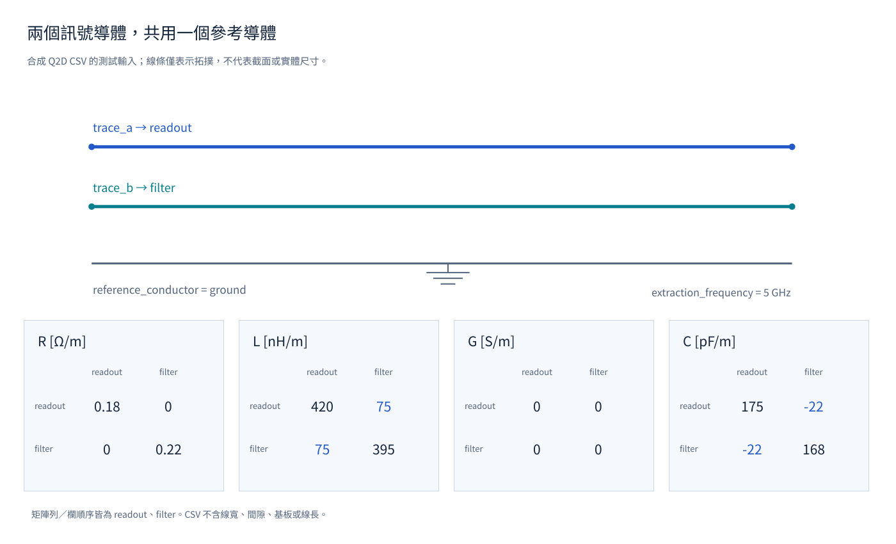

[English](../circuit-data.md) · [繁體中文](circuit-data.md)

這些測試從明確輸入資料與電路宣告開始，檢查 SCNSim 是否保留導體順序與來源身分，以及小型元件網路是否依宣告支路組裝。

## RLGC／Q2D 案例使用什麼資料

Ansys Q2D 是準靜態二維截面擷取工具（quasi-static two-dimensional cross-section extraction），可輸出分佈傳輸線的每單位長度參數。本測試只用合成逗號分隔值檔（CSV）檢查檔案格式與導體對應，不讀取電腦輔助設計（CAD）版圖，也不執行電磁求解器。5 GHz 是擷取頻率中繼資料，不是頻率掃描結果。

檔案依序命名兩條訊號導體 `trace_a`、`trace_b`，並一對一映射至 `readout`、`filter`；`ground` 是接地參考導體（reference conductor），未列入兩條訊號的矩陣列與欄。每單位長度電阻（resistance）、電感（inductance）、電導（conductance）與電容（capacitance）的首字母合稱 RLGC 參數：電阻 `R` 表示串聯導體損耗（Ω/m），電感 `L` 表示自感與互感的磁能儲存（H/m），電導 `G` 表示並聯漏電（S/m），電容 `C` 表示節點電場儲存（F/m）：

```text
R = [[0.18,  0.00], [ 0.00, 0.22]] ohm/m
L = [[420,   75 ], [ 75, 395 ]] nH/m
G = [[0,      0 ], [  0,   0  ]] S/m
C = [[175,  -22 ], [-22, 168 ]] pF/m
```

`C` 的負非對角元素依矩陣慣例表示耦合（coupling），不代表存在負值實體電容。案例沒有線長、導體寬度、間隙、厚度、基板或介電層堆疊，因此無法決定唯一實體幾何；這些數值只說明載入器契約，不是實際截面擷取結果。

{#fig-rlgc-inputs}



[開啟互動式 Plotly 圖](../figures/rlgc-inputs.html)。

## 載入器如何檢查資料

1. 建立 `RLGC` 物件，再檢查有序訊號名稱、參考導體與四個矩陣。嘗試修改回傳陣列及指派屬性；數值必須保持不變，屬性指派必須遭拒。
2. 載入合成 CSV，檢查內容摘要與一對一有序對應。修改 mapping 或檔案內容，確認不完整對應、標頭變更與無效文字都會明確失敗。
3. 提供無效係數與重複導體名稱。測試會以 `SCNSimValidationError` 拒絕非對稱電阻矩陣、非正定電感或電容矩陣、正非對角電導，以及重複名稱。這些是 RLGC 係數檢查，不是另一個已組裝導納矩陣的檢查。來源：[test_rlgc.py](../test_rlgc.py)。

## 元件網路如何組裝

元件工廠（component factory）案例依型錄宣告兩個對稱超導量子干涉元件（superconducting quantum interference device，SQUID），並聯接地。每個約瑟夫森接面（Josephson junction）為 8 nH、2 fF，兩個迴路分別為 4 nH、9 nH，電感耦合（inductive coupling）係數為 0.25，模型另含 50 Ω 端口。

1. 從宣告元件展開後的各支路入射關係（branch incidences），獨立組裝三乘三剛度矩陣 `K`，並使用 `M = k sqrt(La Lb)`。
2. 依測試指定的數值條件界限，將獨立矩陣與編譯出的元件矩陣戳記（matrix stamp）比較。
3. 將互感圖替換為三個 1 nH 電感，兩兩耦合係數為 0.9、0.9、-0.9。完整電感矩陣不是正定矩陣，因此元件宣告必須引發 `SCNSimError`。

這些元件工廠與支路展開測試不會執行非線性或諧波平衡模擬。來源：[test_component_models.py](../test_component_models.py)。
