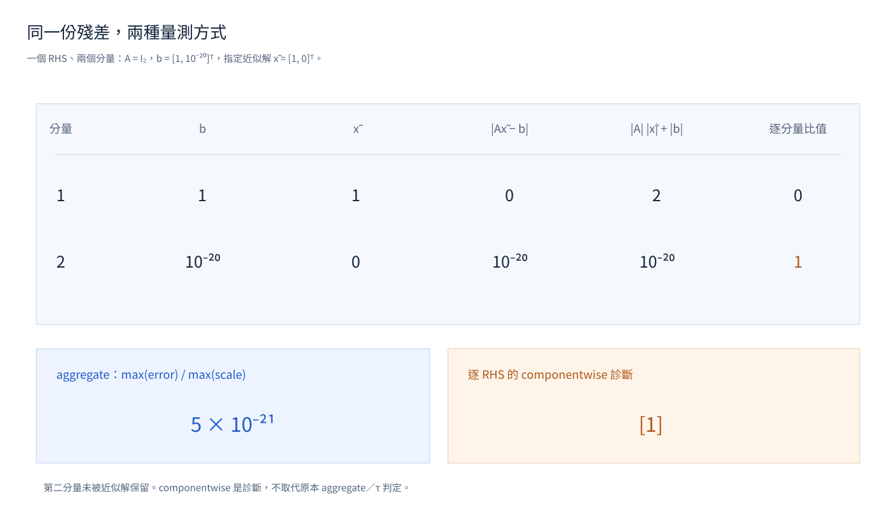

[English](../diagnostics.md) · [繁體中文](diagnostics.md)

這組測試涵蓋三項不同責任：原生錯誤路由（native error routing）必須經過包裝層而不被隱藏；每個方程式的證書（certificate）必須從已編譯的程式完整回傳；線性求解診斷（solve diagnostics）必須描述實際回傳的解。錯誤路由案例只傳遞錯誤，不會求解物理電路。

{#fig-residual-metrics}



[開啟互動式 Plotly 圖](../figures/residual-metrics.html)。

## 原生錯誤路由（Native error routing）

路由案例以真正的 checkify 錯誤內容（error payload）建立純量、批次與封存方程式錯誤。對宣告擁有的錯誤，包裝層必須保留原始狀態（status）、失敗批次索引、來源位置（site）、響應（response）脈絡及錯誤負載（payload）。稀疏方程式範例使用 status 7，測試確認狀態與 payload 位元完整保留。

1. 讓已宣告操作所擁有的稀疏方程式錯誤通過包裝層，確認原始狀態、批次索引、來源位置、響應脈絡與錯誤負載位元都保留。
2. 傳入未知或混合錯誤，確認它以原始執行期錯誤（runtime error）和 cause 重新拋出。無效包裝組合必須遭拒；未啟用的檢查不會變成拋出的失敗。這些案例可抓出被吞掉的原生錯誤，以及包裝層把無法解讀的錯誤誤分類為已知錯誤。來源：[test_native_failure_routing.py](../test_native_failure_routing.py)。

## 編譯程式回傳的方程式證書（Equation certificates）

SCNSim 求解的每個方程式都會回傳一份證書（certificate）：狀態（status）、後向殘差（backward residual）`eta` 及其分子與分母，以及該次求解是否實際執行。這組案例在已編譯的 JAX 程式中求解一個四節點的帶狀複數系統，再把證書逐列讀回。每一列以角色（role）、階段（stage）、導數階數與相依項（dependency）識別。

| 案例 | 各列必須呈現的內容 |
| --- | --- |
| 已解、失敗、略過與未執行 | 未執行的方程式標示為不存在：status 為 0，殘差數值為 NaN。因先前失敗而略過的求解帶有該失敗的 status，並標示為未執行求解。奇異矩陣以其方程式的 stage 作為 status，殘差數值為無限大。 |
| `cond`、`while_loop` 與 `scan` | 每個方程式只保留一列。未選取的分支與一次也沒有執行的迴圈，會使該列不存在。迴圈回報第一次失敗；沒有失敗時，回報最後一次執行。 |
| `vmap` | 每一列在每個批次通道（lane）各有一個項目。通道在它未選取的分支中不存在。 |
| 導數方程式 | 反向模式（reverse mode）增加伴隨（adjoint）列，前向模式（forward mode）增加切線（tangent）列，二階前向導數增加混合（mixed）列，頻率 jet 增加頻率切線（frequency tangent）列。原始方程式失敗時，它的導數方程式會被略過。 |
| 導數可用性 | 零空間向量圖表（null-vector chart）只在它的導數規則實際執行之處記錄導數是否可用，並附上相依項與原因；每個通道分別記錄，反向模式下也會保留。 |
| 循序映射的 Newton 迴圈 | 各通道在不同的迭代次數後停止，其中包含一次也沒有執行的通道與失敗的通道；它們的列仍帶著通道軸回傳。 |
| 單精度 | complex64 運算元的證書數值維持 float32，全域 x64 設定不變。 |

這些案例不斷言任何容許誤差，只檢查 status 代碼、「已執行」與「存在」兩個旗標，以及殘差數值是有限、無限大、NaN 還是恰為零。右手邊為零時殘差恰為零，由此可以看出迴圈回報的是哪一次迭代。

另有一個獨立的測試記錄每一列的來源位置（site）標籤，以及各列回傳的順序。`site` 是方程式在追蹤程式中的位置，JAX 自身的方程式也計算在內，所以其他案例都不依賴它。來源：[test_certificate_transport.py](../test_certificate_transport.py)。

## 求解診斷（Solve diagnostics）

小型單位矩陣案例會區分彙總指標與方程分量診斷。令 `A = I₂`、一個右手邊（right-hand side）向量 `b = [1, 1e-20]`、近似解 `x = [1, 0]`；彙總正規化殘差為 `5e-21`，第二個方程分量（equation component）的殘差則為 1。彙總指標符合原有求解器門檻，但逐右手邊（per-right-hand-side, per-RHS）診斷會指出該分量的錯誤。另一個兩欄案例才是兩個右手邊，檢查值為 `[1, 0]`，其中第二個解欄完全正確。

1. 稠密（dense）案例將診斷與實際原始解比較。
2. 稀疏（sparse）與補償求解（compensated solve）路徑保留原解及四個輔助純量。

測試確認診斷欄位描述實際執行的求解，不新增門檻，也不讓彙總掩蓋不正確的分量。來源：[test_solve_diagnostics.py](../test_solve_diagnostics.py)。
