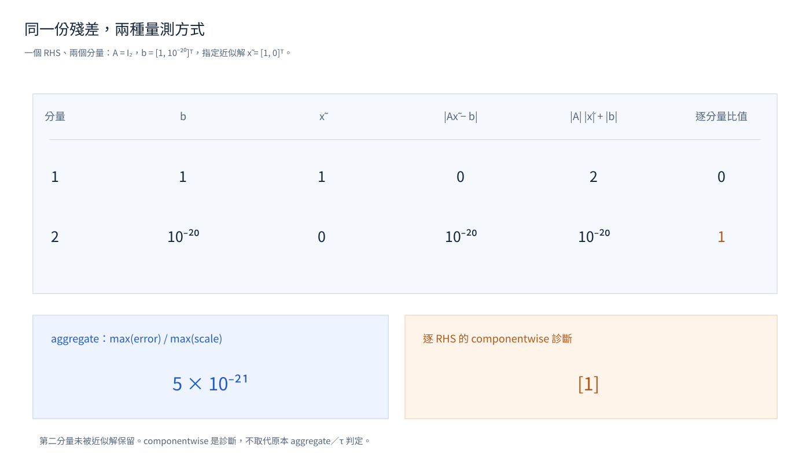

[English](../diagnostics.md) · [繁體中文](diagnostics.md)

這組測試涵蓋兩項不同責任：原生錯誤路由（native error routing）必須經過包裝層而不被隱藏；線性求解診斷（solve diagnostics）必須描述實際回傳的解。錯誤路由案例只傳遞錯誤，不會求解物理電路。

{#fig-residual-metrics}



[開啟互動式 Plotly 圖](../figures/residual-metrics.html)。

## 原生錯誤路由（Native error routing）

路由案例以真正的 checkify 錯誤內容（error payload）建立純量、批次與封存方程式錯誤。對宣告擁有的錯誤，包裝層必須保留原始狀態（status）、失敗批次索引、來源位置（site）、響應（response）脈絡及錯誤負載（payload）。稀疏方程式範例使用 status 7，測試確認狀態與 payload 位元完整保留。

1. 讓已宣告操作所擁有的稀疏方程式錯誤通過包裝層，確認原始狀態、批次索引、來源位置、響應脈絡與錯誤負載位元都保留。
2. 傳入未知或混合錯誤，確認它以原始執行期錯誤（runtime error）和 cause 重新拋出。無效包裝組合必須遭拒；未啟用的檢查不會變成拋出的失敗。這些案例可抓出被吞掉的原生錯誤，以及包裝層把無法解讀的錯誤誤分類為已知錯誤。來源：[test_native_failure_routing.py](../test_native_failure_routing.py)。

## 求解診斷（Solve diagnostics）

小型單位矩陣案例會區分彙總指標與方程分量診斷。令 `A = I₂`、一個右手邊（right-hand side）向量 `b = [1, 1e-20]`、近似解 `x = [1, 0]`；彙總正規化殘差為 `5e-21`，第二個方程分量（equation component）的殘差則為 1。彙總指標符合原有求解器門檻，但逐右手邊（per-right-hand-side, per-RHS）診斷會指出該分量的錯誤。另一個兩欄案例才是兩個右手邊，檢查值為 `[1, 0]`，其中第二個解欄完全正確。

1. 稠密（dense）案例將診斷與實際原始解比較。
2. 稀疏（sparse）與補償求解（compensated solve）路徑保留原解及四個輔助純量。

測試確認診斷欄位描述實際執行的求解，不新增門檻，也不讓彙總掩蓋不正確的分量。來源：[test_solve_diagnostics.py](../test_solve_diagnostics.py)。
